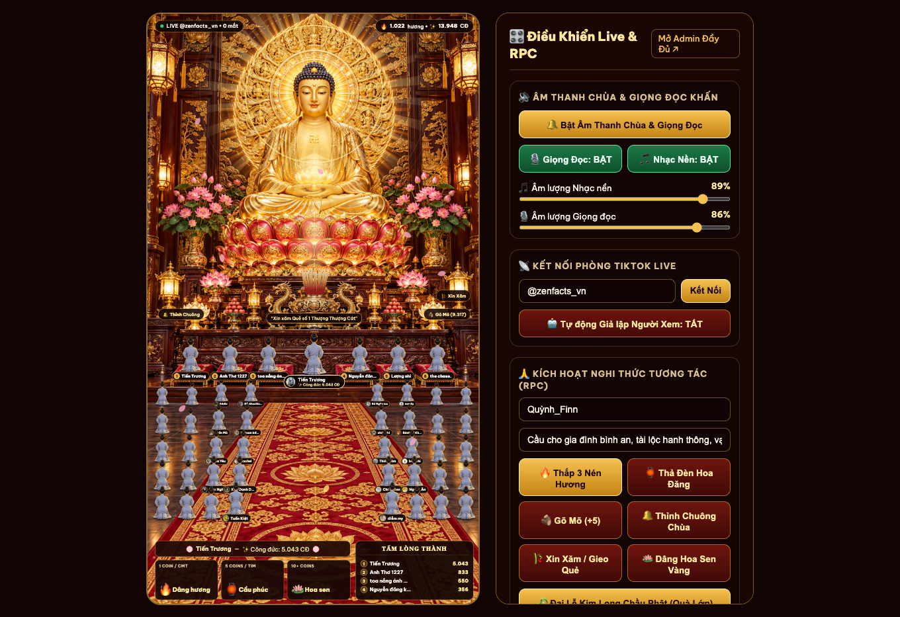
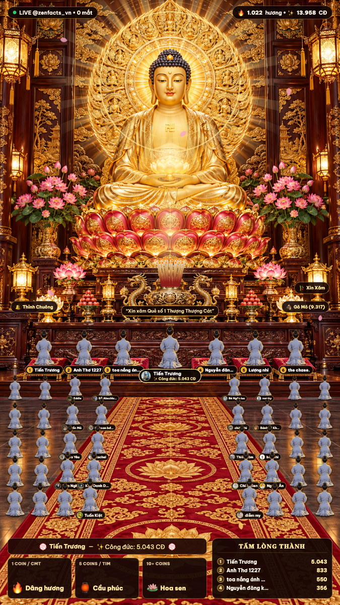
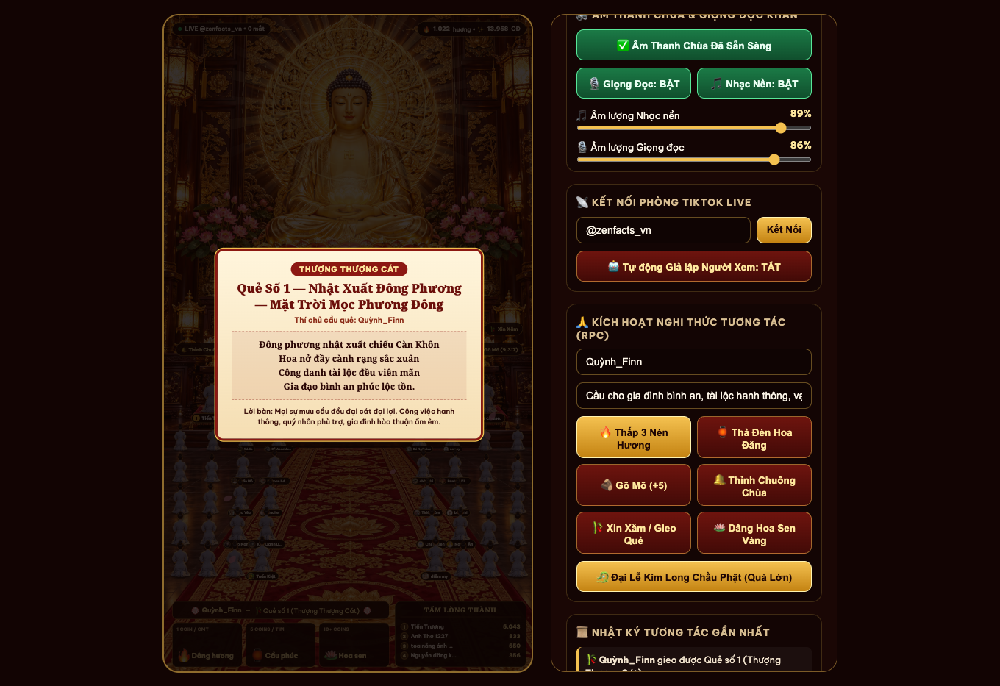
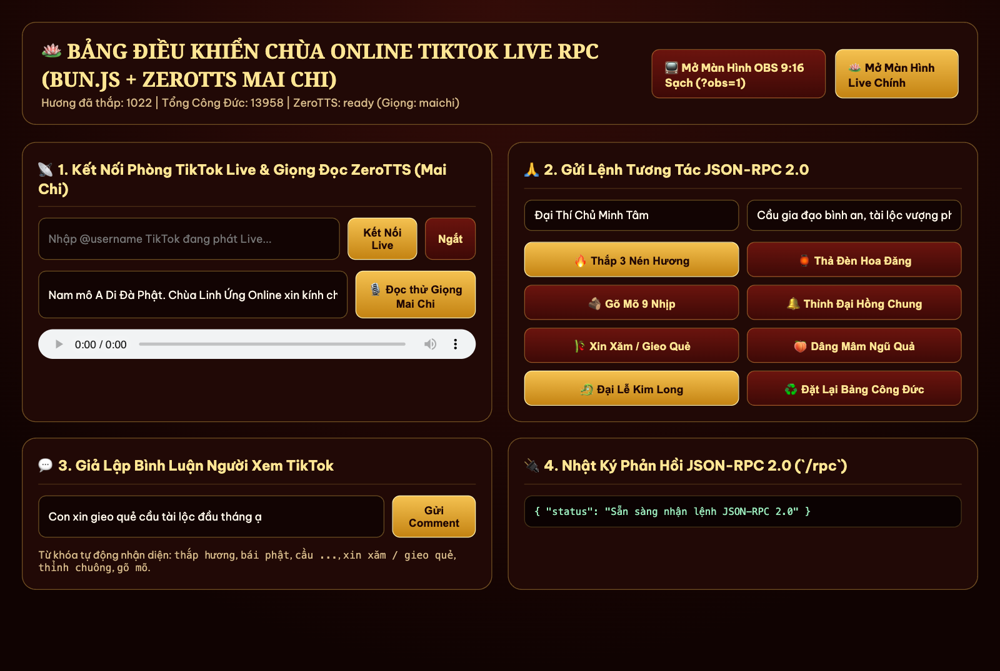

# 🪷 วัดหลิงอิ๋งออนไลน์ — TikTok Live RPC (วิหารพุทธแบบโต้ตอบ 9:16)

ระบบไลฟ์สตรีมแบบโต้ตอบ (**Interactive TikTok Live Stream & JSON-RPC 2.0**) เฟรมแนวตั้ง **9:16 (`1080×1920`)** สำหรับ **OBS Studio / TikTok Live Studio** ทำงานเบามากบน **Bun.js** พร้อมเสียงอ่านภาษาไทย **Edge TTS (`th-TH-PremwadeeNeural`)**

ผู้ชมบน TikTok Live โต้ตอบโดยตรงผ่าน **คอมเมนต์ (Comment)**, **กดหัวใจ (Like)**, **แชร์ / ติดตาม (Follow)** และ **ส่งของขวัญ (Gift)** เพื่อร่วมพิธีทางจิตวิญญาณบนหน้าจอพระอุโบสถ **พระอมิตาภพุทธเจ้า**:
- 🔥 **จุดธูป & กราบเบญจางคประดิษฐ์ (8-Frame Walking & Prostration)**: ตัวละครพุทธศาสนิกชนในชุดสีฟ้าครามเดินตามพรมแดงดอกบัวไปหน้ากระถางธูปทองเหลือง คุกเข่าและกราบ 3 ครั้งเบญจางคประดิษฐ์ไปทางพระอมิตาภพุทธเจ้า
- 🏮 **ลอยโคม / ใบอธิษฐาน**: คอมเมนต์คำอธิษฐานจะลอยขึ้นเป็นโคมลอย พร้อมเสียง AI อ่านคำอธิษฐาน
- 🎋 **เสี่ยงเซียมซี / ทำนายต้นปี (ซิงก์เสียงอ่าน & ใบทำนาย)**: เขย่ากระบอกเซียมซีและเปิดใบทำนาย (มงคลยิ่งยวด, มงคลใหญ่, มงคลสูง...) ตรงจังหวะที่เสียงอ่านเริ่มดังขึ้น
- 🪵 **เคาะระฆังไม้ & 🔔 ตีระฆังใหญ่**: กดหัวใจเคาะระฆังไม้สะสมบุญ แชร์/ติดตามเพื่อตีระฆังทองเหลืองให้คลื่นเสียงสีทองแผ่ไป และกระตุ้นคลื่นการกราบของพุทธศาสนิกชน 40+ คนในลานพิธี
- 📜 **กระดานทองแห่งบุญ (`ศรัทธาจิต` & 6 เบาะกราบ VIP)**: ยกย่องผู้ชมจริงที่มีแต้มบุญสูงสุดบนเบาะกราบผ้าแพรแดง 6 ที่หน้าโต๊ะบูชาพระ

---

## 📸 ภาพตัวอย่างหน้าจอ

### 1. หน้าจอพระอุโบสถ 9:16 & แผงควบคุมด่วน (`http://localhost:3000`)


### 2. โหมด OBS Browser Source 9:16 แบบสะอาด (`http://localhost:3000/?obs=1`) & เสี่ยงเซียมซี
| หน้าจอ OBS 9:16 (`?obs=1`) | ใบทำนายเซียมซี (ซิงก์เสียงอ่าน) |
| :---: | :---: |
|  |  |

### 3. แผงควบคุม JSON-RPC 2.0 & แอดมิน (`http://localhost:3000/admin`)


---

## ⚡ สถาปัตยกรรม & การเพิ่มประสิทธิภาพ (เบามาก CPU/GPU)

- **Runtime**: รันตรงบน **Bun.js** (`~0.1% CPU` ขณะว่าง)
- **Canvas Particle Engine (`public/js/particles.js`)**:
  - ล็อกอัตราวาดที่ **30 FPS** คงที่ และหยุดอัตโนมัติเมื่อซ่อนแท็บ (`document.hidden`)
  - เรนเดอร์ควันธูป ผงทอง และกลีบดอกบัวล่วงหน้าลง Offscreen Canvas ครั้งเดียวตอนเริ่มต้น (`drawImage`) ไม่เรียก `createRadialGradient` หรือ `shadowBlur` ในลูปเฟรม
- **Zero-Flicker 8-Frame Sprite Stack (`public/js/live.js` & `public/css/live.css`)**:
  - โหลดเฟรมเคลื่อนไหวทั้ง 8 เฟรม (`walk1`, `walk2`, `kneelDown`, `kneel`, `forehead`, `bowMid`, `prostrate`, `prostrateDeep`) เข้า GPU พร้อมเงา (drop-shadow) ที่ฝังในไฟล์ PNG แล้ว ขจัดอาการกะพริบ/ภาพหายตอนเปลี่ยนท่า
- **TTS Worker (`tts_worker.py`)**:
  - โปรเซส Python ประจำที่ เรียกเสียงอ่านภาษาไทยผ่าน [`edge-tts`](https://github.com/rany2/edge-tts) (เสียง `premwadee` / `niwat` / `achara`) แคชไฟล์ `.mp3` ไว้ใน `data/tts-cache/`
  - **ต้องมีอินเทอร์เน็ต** (ใช้บริการเสียงออนไลน์ของ Microsoft แบบไม่เป็นทางการ ไม่ต้องใช้ API key) หากต้องการทำงานออฟไลน์ ให้เปลี่ยน worker เป็น Piper/VITS ภาษาไทย
- **ตัวกรองอักขระแปลก & สแปม (`server.js` & `tts_worker.py`)**:
  - บล็อกอัตโนมัติสำหรับอักขระ Cuneiform (`𒐫`), อักษรอาหรับที่ทำให้ค้าง, Braille, Zalgo, คอมเมนต์ที่เป็นจุดล้วน (`...`) หรือคำไม่สุภาพ
  - ปรับ Unicode ให้เป็นมาตรฐานอัตโนมัติ (`NFKC` → `NFC`) แปลงชื่อที่ใช้ตัวอักษรทางคณิตศาสตร์ให้เป็นข้อความปกติก่อนอ่าน TTS

---

## 🚀 วิธีติดตั้ง & เริ่มใช้งานเร็ว

### 1. ความต้องการของระบบ
- [Bun.js](https://bun.sh/) (`>= 1.1`)
- Python `3.10+` & [`uv`](https://github.com/astral-sh/uv) (สำหรับสร้างสภาพแวดล้อม `.venv` เพื่อรัน `edge-tts`)

### 2. ติดตั้งไลบรารี
```bash
# ติดตั้ง dependencies สำหรับ Bun / Node
bun install

# สร้างสภาพแวดล้อม Python .venv และติดตั้ง edge-tts
uv venv .venv
uv pip install --python .venv/bin/python -r requirements.txt
```

### 3. เริ่มเซิร์ฟเวอร์
```bash
bun start
# หรือโหมดรีโหลดอัตโนมัติเมื่อแก้โค้ด:
bun run dev
```

โดยค่าเริ่มต้นเซิร์ฟเวอร์ทำงานที่พอร์ต `3000`:
- **หน้าจอไลฟ์ + ควบคุมด่วน**: [http://localhost:3000](http://localhost:3000)
- **หน้าจอ OBS Browser Source (สะอาด 9:16)**: [http://localhost:3000/?obs=1](http://localhost:3000/?obs=1) *(ตั้งขนาด Browser Source ใน OBS เป็น `1080 × 1920`)*
- **แผงควบคุมแอดมิน & RPC**: [http://localhost:3000/admin](http://localhost:3000/admin)

---

## 🎮 ตารางกติกาการโต้ตอบ TikTok Live

| เหตุการณ์ TikTok Live | เงื่อนไข / คีย์เวิร์ด | พิธีบนพระอุโบสถ | แต้มบุญ |
| :--- | :--- | :--- | :---: |
| **กดหัวใจ (Like)** | ทุกรอบที่กดหัวใจ | เคาะระฆังไม้สวดมนต์ + คลื่นพุทธศาสนิกชนกราบไหว้ | `+1` / หัวใจ |
| **ติดตาม / แชร์** | กดติดตามหรือแชร์ | ตีระฆังใหญ่ดังก้อง + คลื่นเสียงสีทอง | `+10` |
| **คอมเมนต์จุดธูป** | `จุดธูป`, `ถวายธูป`, `กราบพระ`, `ไหว้พระ` | พุทธศาสนิกชนเดินตามพรมแดงไปหน้ากระถางธูป คุกเข่ากราบ 3 ครั้ง + อ่านชื่อผู้อธิษฐาน | `+15` |
| **คอมเมนต์อธิษฐาน** | `ขอ ...`, `อธิษฐาน ...`, `นะโม`, `อมิตาพุทธ`, `สุขสงบ`, `ขอให้ ...` | เดินไปกราบ + ลอยโคมนำคำอธิษฐานขึ้นฟ้า + อ่านคำอธิษฐาน | `+10` |
| **คอมเมนต์เซียมซี** | `เซียมซี`, `เสี่ยงเซียมซี`, `จับสลาก`, `ใบทำนาย` | เขย่ากระบอกเซียมซี + เปิดใบทำนายซิงก์ตรงจังหวะที่เสียงอ่านเริ่มดัง | `+10` |
| **ของขวัญเล็ก (1–4 เหรียญ)** | กุหลาบ (Rose), Heart Me... | เดินไปถวายฐานดอกบัวทอง + จุดธูป 3 ดอก + อ่านคำอนุโมทนา | `+20` / เหรียญ |
| **ของขวัญกลาง (5–99 เหรียญ)** | ตะเกียงแก้วลาซูลี, พานผลไม้ห้าสี... | ถวายตะเกียงแก้ว / พานผลไม้ห้าสี + ตีระฆัง + อ่านคำอวยพร | `+30` / เหรียญ |
| **ของขวัญใหญ่ (≥ 100 เหรียญ)** | ของขวัญ ≥ 100 เหรียญ | **พิธีมังกรทองถวายพระ**: ฝนดอกบัวทอง รัศมีอนันต์ ระฆังทองเหลืองดังก้อง | `+50` / เหรียญ |

---

## 🔌 โปรโตคอล JSON-RPC 2.0 (`POST /rpc` & `ws://localhost:3000/ws`)

เรียกใช้ตรงจาก **TikFinity**, **Streamer.bot**, webhook หรือ `curl` ได้:

```bash
# 1. จุดธูปขอพร
curl -X POST http://localhost:3000/rpc \
  -H "Content-Type: application/json" \
  -d '{
    "jsonrpc": "2.0",
    "id": 1,
    "method": "temple.burnIncense",
    "params": {
      "user": "ผู้ร่วมบุญมิ่งใจ",
      "count": 3,
      "wish": "ขอให้ครอบครัวร่มเย็นเป็นสุข สิ่งมงคลสมปรารถนา"
    }
  }'

# 2. เสี่ยงเซียมซีต้นปี
curl -X POST http://localhost:3000/rpc \
  -H "Content-Type: application/json" \
  -d '{
    "jsonrpc": "2.0",
    "id": 2,
    "method": "temple.drawFortune",
    "params": {
      "user": "ผู้ร่วมบุญมิ่งใจ",
      "topic": "ขอโชคลาภและความสุขสงบในครอบครัว"
    }
  }'

# 3. เชื่อมต่อห้อง TikTok Live (@username หรือลิงก์ vt.tiktok.com)
curl -X POST http://localhost:3000/rpc \
  -H "Content-Type: application/json" \
  -d '{
    "jsonrpc": "2.0",
    "id": 3,
    "method": "live.connect",
    "params": {
      "username": "@zenfacts_vn"
    }
  }'
```

### รายการ JSON-RPC Methods ที่รองรับ:
- `temple.getState`: ดึงสถานะพระอุโบสถและกระดานทองแห่งบุญทั้งหมด
- `temple.burnIncense`: จุดธูป & เดินไปกราบ (`user`, `avatar`, `count`, `wish`)
- `temple.sendPrayer`: ลอยโคมอธิษฐาน (`user`, `avatar`, `wish`)
- `temple.drawFortune`: เขย่ากระบอก & เสี่ยงเซียมซี (`user`, `avatar`, `topic`)
- `temple.strikeWoodenFish`: เคาะระฆังไม้สะสมบุญ (`user`, `count`)
- `temple.ringBell`: ตีระฆังใหญ่ (`user`, `count`, `wish`)
- `temple.offerGift`: ถวายเครื่องสักการะ (`user`, `giftType`: `lotus` | `fruit` | `lamp` | `dragon`, `coins`, `giftName`)
- `temple.grandCeremony`: เริ่มพิธีมังกรทองถวายพระ (`user`, `coins`, `giftName`)
- `temple.updateSettings`: ปรับระดับเสียงเพลงประกอบ (`musicVolume`), เสียงอ่าน (`ttsVolume`), เปิด/ปิด TTS
- `temple.resetMerit`: รีเซ็ตสถิติบุญ
- `live.connect` / `live.disconnect`: เชื่อมต่อ / ตัดการเชื่อมต่อห้อง TikTok Live

---

## 📁 โครงสร้างโฟลเดอร์

```text
├── server.js                  # เซิร์ฟเวอร์ Bun.js HTTP + WebSocket JSON-RPC 2.0 & TikTok Live Connector
├── tts_worker.py              # โปรเซส Python TTS ภาษาไทย (edge-tts, กรองอักขระแปลก)
├── data/
│   ├── merit-state.json       # เก็บกระดานทองแห่งบุญของผู้ชมจริงอย่างถาวร
│   └── tts-cache/             # แคชไฟล์เสียง MP3 ที่สังเคราะห์แล้ว
├── public/
│   ├── index.html             # หน้าพระอุโบสถ 9:16 + แผงควบคุมด่วน
│   ├── admin.html             # หน้าแอดมิน JSON-RPC 2.0 แบบเต็ม
│   ├── css/live.css           # Stylesheet เพิ่มประสิทธิภาพ GPU Compositor
│   ├── js/
│   │   ├── live.js            # ควบคุม 8-frame prostration, ลานพิธี 40 ที่นั่ง & WebSocket RPC
│   │   ├── particles.js       # 30 FPS Offscreen-Sprite Particle Engine (ควันธูป, ดอกบัว, คลื่นเสียง)
│   │   └── audio.js           # จัดการเพลงประกอบ auto-ducking, เครื่องพิธี Web Audio & คิวซิงก์ TTS
│   └── assets/                # ภาพพื้นหลังพระอมิตาภพุทธเจ้า, 8 เฟรมพุทธศาสนิกชนชุดสีฟ้าคราม & เพลงประกอบ
└── docs/
    ├── demo/                  # ภาพหน้าจอตัวอย่างจริง
    └── superpowers/specs/     # เอกสารออกแบบทางเทคนิค (Design Spec)
```

---

## 🙏 ที่มาของโปรเจกต์ (Origin & Credits)

โปรเจกต์นี้เป็นงานต่อยอด (derivative) จาก **[zane-tv/tiktok-live-temple-rpc](https://github.com/zane-tv/tiktok-live-temple-rpc)** (ต้นฉบับภาษาเวียดนาม "Chùa Linh Ứng Online") ผ่านเวอร์ชัน fork [aigrouphobinh/tiktok-live-temple-rpc](https://github.com/aigrouphobinh/tiktok-live-temple-rpc) ซึ่งเพิ่มฉาก 3 มิติและระบบของขวัญ

สิ่งที่เปลี่ยนในเวอร์ชันนี้: แปลข้อความและเมนูทั้งหมดเป็นภาษาไทย, เพิ่มคีย์เวิร์ดคอมเมนต์ภาษาไทย, เปลี่ยนเสียงอ่านจาก ZeroTTS (เวียดนาม) เป็น Edge TTS ภาษาไทย

## 📄 สัญญาอนุญาต (License)

การแก้ไขและส่วนที่เพิ่มใหม่ในเวอร์ชันนี้เผยแพร่ภายใต้ [MIT License](LICENSE)

⚠️ **หมายเหตุ:** ณ วันที่สร้างโปรเจกต์นี้ ต้นฉบับ `zane-tv/tiktok-live-temple-rpc` ยังไม่ได้ระบุสัญญาอนุญาต ส่วนที่มาจากต้นฉบับจึงยังเป็นลิขสิทธิ์ของผู้เขียนเดิม หากเจ้าของต้นฉบับขอให้ลบหรือแก้ไข ผู้ดูแลโปรเจกต์นี้จะดำเนินการทันที
